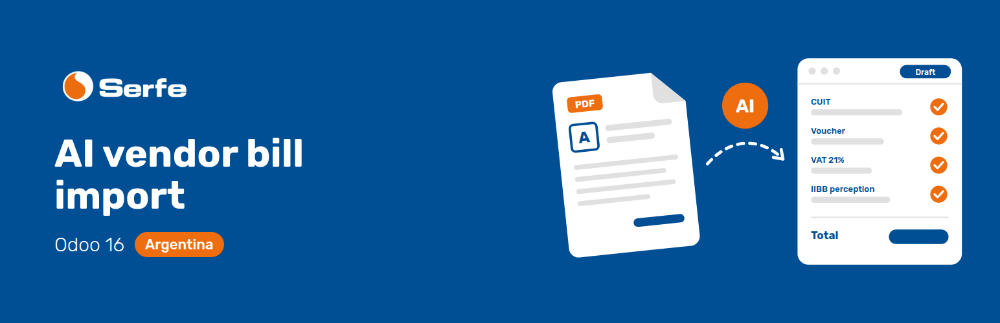
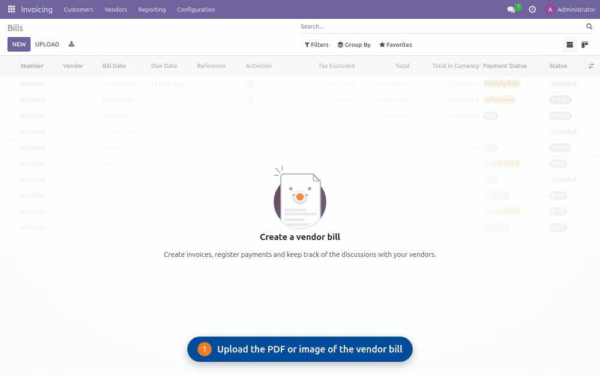

# AI vendor bill import for Odoo (Argentina)

> Read supplier invoices from a PDF or image with AI and get a draft vendor bill ready for review in Odoo.

[Español](README.md) · English

## The problem

Loading vendor bills by hand is repetitive: copying the vendor, CUIT, voucher type, point of sale and number, dates, VAT and perceptions, line by line. It takes operating time and invites typing mistakes.

## What it does

* **Reads the invoice** from a PDF or an image and creates a **draft vendor bill**. It never posts it.
* **Understands Argentine invoices:** the vendor's CUIT, the voucher letter (A, B or C) and the matching Latam document type, point of sale and number as printed, day-first dates, the printed VAT rate, and perceptions (IIBB and VAT) applied as the matching AFIP tax.
* **Keeps unusual VAT rates**, such as 27% on telecom, gas or electricity, because your company's purchase VAT rates are part of what the model is given.
* **Is built to be reviewed:** a step that cannot be resolved leaves the draft as extracted instead of blocking the import.

## How it works

### Uploading a PDF or an image

1. On a vendor bill or refund list, press *Upload* and choose the PDF or image.
2. The document is read and the data is extracted with the model you configured.
3. A review wizard opens with the result. You check totals, taxes and the vendor, fix what is needed and post.

### On an existing bill

1. Open the draft vendor bill that already has the PDF or image attached.
2. Press *Process with AI*.
3. The extracted data fills in the form of the draft. Review it and post.

## Limitations

* **Argentina only.** The extraction is tuned for AFIP invoices (CUIT, voucher letters, AFIP taxes, `l10n_ar`). Other countries, such as Uruguay, are not covered: [contact us](https://www.serfe.com/en/contact-us) if you need them.
* **Odoo 16 Community only.** Other versions have not been reviewed.
* **The model can be wrong.** The result is a suggestion: check totals, taxes and the vendor before posting. Poor scans or unusual layouts may give incomplete drafts.

## Costs and data

* **No license fee.** The modules are free and open source.
* **Your costs:** the usage of your AI provider, which depends on the provider, the model and the size of the documents. Serfe does not provide the AI service.
* **Your data:** only after company opt-in, Odoo sends the full invoice, its transcription, extraction prompts, and company name, CUIT, currency and purchase VAT rates to your configured endpoint. That endpoint may forward data to other providers. Review their privacy and retention terms.
* **Your API key:** Odoo stores it in the provider record; only LLM Managers can read it through the ORM. Restrict database and backup access, use scoped credentials, and rotate keys used with versions before `16.0.1.1.0`.

## Requirements

* Odoo 16 Community, with `l10n_ar` for the Argentine behavior.
* A LiteLLM or OpenAI-compatible endpoint with `/models`, document input via streaming `/responses`, and `/chat/completions`. Not every provider or model supports both document input and chat.

## Installation

1. Clone this repository (branch `16.0`) and the repositories listed in `oca_dependencies.txt`.
2. Add them to the `addons_path` of Odoo.
3. Install the Python dependencies: `pip install -r requirements.txt`.
4. Update the apps list and install `serfe_invoice_ocr` (shown in Apps as *Argentina Invoice OCR*). Its dependencies, including the vendored import base from [Apexive](https://github.com/apexive/odoo-llm), are installed with it.

Each module has its own README.

## Configuration

1. In *LLM → Configuration → Providers*, open the provider, fill in the *API Base* and *API Key* of your AI provider, and press *Fetch Models* to import its models. The module connects to your provider's API: see its documentation to get the API URL and key. If you prefer, [contact us](https://www.serfe.com/en/contact-us) and we will help you.
2. Assign a model to the *Invoice Extraction* assistant (*LLM → Configuration → Assistants*).
3. As an administrator, open *Settings → Users & Companies → Companies → Invoice AI*, review the notice, then enable **Allow external AI invoice processing** for each company that authorizes the transfer. On upgrade, existing credentials are kept, but AI stays off until opt-in.

Revoke the company option to turn off future invoice AI requests for that company, or archive *Invoice Extraction* to turn it off globally. *Upload* returns to Odoo's standard decoders. Use HTTPS outside a trusted private network. Files must be PDF, PNG or JPEG and at most 20 MiB. Direct LiteLLM use outside invoice OCR requires LLM Manager or the optional LLM Chatter group.

See the [release audit and checklist](docs/ODOO_APPS_RELEASE.md).

## Collaboration & Support

* **Contributing:** read [CONTRIBUTING.en.md](CONTRIBUTING.en.md) for guidelines and local verification steps.

## About Serfe

[Serfe](https://www.serfe.com/en/) is a software development company that specializes in building high-quality, scalable web applications and integrations. We are committed to open source and to helping organizations embrace modern web standards, including the emerging Agentic Web. These modules are part of that work, and we can support you all the way:

* **Implementation and setup:** we get the connection to your AI provider and the import working in your Odoo.
* **Adaptation to your case:** other countries (for example Uruguay), your own voucher formats and your business rules.
* **Support and training** for your accounting team.
* **Infrastructure options** when your case needs them.

Learn more at [serfe.com](https://www.serfe.com/en/) and [tell us what you need](https://www.serfe.com/en/contact-us).

## License

Mixed, per module. See [LICENSE](LICENSE).
