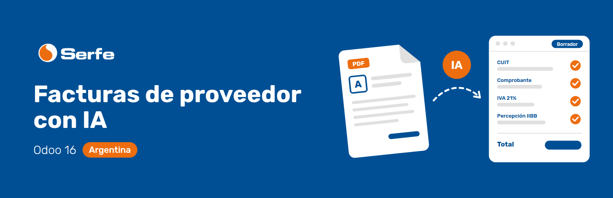

# AI vendor bill import for Odoo (Argentina)

> Read supplier invoices from a PDF or image with AI and get a draft vendor bill ready for review in Odoo.

[Español](README.md) · English

## The problem

Loading vendor bills by hand is repetitive: copying the vendor, CUIT, voucher type, point of sale and number, dates, VAT and perceptions, line by line. It takes operating time and invites typing mistakes.

## What it does

* **Reads the invoice** from a PDF or an image and creates a **draft vendor bill**. It never posts it.
* **Understands Argentine invoices:** the vendor's CUIT, the voucher letter (A, B or C) and the matching Latam document type, point of sale and number as printed, day-first dates, the printed VAT rate, and perceptions (IIBB and VAT) applied as the matching AFIP tax.
* **Keeps unusual VAT rates**, such as 27% on telecom, gas or electricity, because your company's purchase VAT rates are part of what the model is given.
* **Is built to be reviewed:** a step that cannot be resolved leaves the draft as extracted instead of blocking the import.

## How it works

It is built on [`account_invoice_import`](https://github.com/OCA/edi) from OCA, so vendor, product and tax matching are the standard ones.

### Uploading a PDF or an image

1. On a vendor bill or refund list, press *Upload* and choose the PDF or image.
2. The document is read and the data is extracted with the model you configured.
3. A review wizard opens with the result. You check totals, taxes and the vendor, fix what is needed and post.

### On an existing bill

1. Open the draft vendor bill that already has the PDF or image attached.
2. Press *Process with AI*.
3. The extracted data fills in the form of the draft. Review it and post.

## Limitations

* **Argentina only.** The extraction is tuned for AFIP invoices (CUIT, voucher letters, AFIP taxes, `l10n_ar`). Other countries, such as Uruguay, are not covered: [contact us](https://www.serfe.com/en/) if you need them.
* **Odoo 16 Community only.** Other versions have not been reviewed.
* **The model can be wrong.** The result is a suggestion: check totals, taxes and the vendor before posting. Poor scans or unusual layouts may give incomplete drafts.

## Costs and data

* **No license fee.** The modules are free and open source.
* **Your costs:** the usage of your AI provider, which depends on the provider, the model and the size of the documents. Serfe does not provide the AI service.
* **Your data:** each invoice is sent to the AI provider that you configure. Serfe does not receive it. Check your provider's data policy before processing documents.
* **Your API key:** it is stored in the Odoo provider record, and every internal user can read it. Use a key with a limited budget, or restrict who has internal user access.

## Requirements

* Odoo 16 Community, with `l10n_ar` for the Argentine behavior.
* An AI provider account (OpenAI, Anthropic, Mistral, etc.), provided by you.

## Installation

1. Clone this repository (branch `16.0`) and the repositories listed in `oca_dependencies.txt`.
2. Add them to the `addons_path` of Odoo.
3. Install the Python dependencies: `pip install -r requirements.txt`.
4. Update the apps list and install `serfe_invoice_ocr` (shown in Apps as *Serfe Invoice OCR*). It is the Serfe module and the only one you need to install: its dependencies, including the vendored import base from [Apexive](https://github.com/apexive/odoo-llm), are installed with it.

Each module has its own README.

## Configuration

1. Set up the connection to your AI provider following the documentation of the base module: [`apx_llm_litellm`](apx_llm_litellm/README.en.md). If you prefer, [contact us](https://www.serfe.com/en/) and we will help you.
2. Assign a model to the *Invoice Extraction* assistant (*LLM → Configuration → Assistants*).

To turn the AI import off, archive the *Invoice Extraction* assistant: *Upload* goes back to Odoo's standard decoders.

## Collaboration & Support

* **Contributing:** read [CONTRIBUTING.en.md](CONTRIBUTING.en.md) for guidelines and local verification steps.

## About Serfe

[Serfe](https://www.serfe.com/en/) is a software development company that specializes in building high-quality, scalable web applications and integrations. We are committed to open source and to helping organizations embrace modern web standards, including the emerging Agentic Web. These modules are part of that work, and we can support you all the way:

* **Implementation and setup:** we get the connection to your AI provider and the import working in your Odoo.
* **Adaptation to your case:** other countries (for example Uruguay), your own voucher formats and your business rules.
* **Support and training** for your accounting team.
* **Infrastructure options** when your case needs them.

Learn more and tell us what you need at [serfe.com](https://www.serfe.com/en/).

## License

Mixed, per module. See [LICENSE](LICENSE).