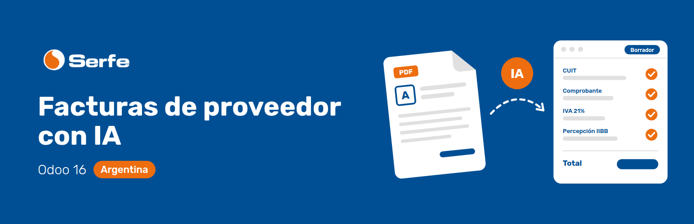

# Importación de facturas de proveedor con IA para Odoo (Argentina)

> Leé facturas de proveedor en PDF o imagen con IA y obtené un borrador listo para revisar en Odoo.

Español · [English](README.en.md)

## El problema

Cargar a mano las facturas de proveedores es repetitivo: copiar el proveedor, el CUIT, el tipo de comprobante, punto de venta y número, las fechas, el IVA y las percepciones, línea por línea. Lleva tiempo operativo y se presta a errores de tipeo.

## Qué hace

* **Lee la factura** desde un PDF o una imagen y crea un **borrador de factura de proveedor**. Nunca la publica.
* **Entiende facturas argentinas:** el CUIT del proveedor, la letra del comprobante (A, B o C) y el tipo de documento Latam que le corresponde, punto de venta y número como están impresos, fechas día-mes-año, la alícuota de IVA impresa, y las percepciones (IIBB e IVA) aplicadas como el impuesto AFIP correspondiente.
* **Respeta alícuotas inusuales**, como 27% en telecomunicaciones, gas o electricidad, porque las alícuotas de IVA de compras de tu compañía son parte de lo que recibe el modelo.
* **Está pensado para revisarse:** un paso que no se puede resolver deja el borrador tal como fue extraído, en vez de bloquear la importación.

## Cómo funciona

Está construido sobre [`account_invoice_import`](https://github.com/OCA/edi) de OCA, así que el reconocimiento de proveedor, producto e impuestos es el estándar.

### Subiendo un PDF o una imagen

1. En la lista de facturas o notas de crédito de proveedor, presioná *Upload* y elegí el PDF o la imagen.
2. Se lee el documento y se extraen los datos con el modelo que configuraste.
3. Se abre un asistente de revisión con el resultado. Verificás totales, impuestos y proveedor, corregís lo necesario y publicás.

### Sobre una factura ya creada

1. Abrí el borrador de factura de proveedor que ya tiene el PDF o la imagen adjunto.
2. Presioná *Process with AI*.
3. Los datos extraídos completan el formulario del borrador. Revisalos y publicá.

## Limitaciones

* **Solo Argentina.** La extracción está afinada para comprobantes AFIP (CUIT, letras, impuestos AFIP, `l10n_ar`). Otros países, como Uruguay, no están cubiertos: [contactanos](https://www.serfe.com/) si lo necesitás.
* **Solo Odoo 16 Community.**
* **El modelo puede equivocarse.** El resultado es una sugerencia: verificá totales, impuestos y proveedor antes de publicar. Escaneos de mala calidad o diseños poco comunes pueden dar borradores incompletos.

## Costos y datos

* **Sin costo de licencia.** Los módulos son gratuitos y de código abierto.
* **Tus costos:** el uso de tu proveedor de IA, que depende del proveedor, del modelo y del tamaño de los documentos.
* **Tus datos:** cada factura se envía al proveedor de IA que configurás. Revisá la política de datos de tu proveedor antes de procesar documentos.
* **Tu clave de API:** se guarda en el registro del proveedor de Odoo y todos los usuarios internos pueden leerla. Usá una clave con presupuesto limitado, o restringí quién tiene acceso como usuario interno.

## Requisitos

* Odoo 16 Community, con `l10n_ar` para el comportamiento argentino.
* Una cuenta con un proveedor de IA (OpenAI, Anthropic, Mistral, etc.).

## Instalación

1. Clonar este repositorio (rama `16.0`) y los repositorios de `oca_dependencies.txt`.
2. Agregarlos al `addons_path` de Odoo.
3. Instalar las dependencias de Python: `pip install -r requirements.txt`.
4. Actualizar la lista de aplicaciones e instalar `serfe_invoice_ocr` (en Aplicaciones aparece como *Serfe Invoice OCR*). Es el módulo de Serfe y el único que hay que instalar: sus dependencias, incluida la base de importación vendorizada de [Apexive](https://github.com/apexive/odoo-llm), se instalan con él.

Cada módulo tiene su propio README.

## Configuración

1. En *LLM → Configuración → Proveedores*, abrí el proveedor, completá *API Base* y *API Key* con los datos de tu proveedor de IA y presioná *Fetch Models* para traer sus modelos. El módulo se conecta a la API de tu proveedor: consultá su documentación para obtener la URL de la API y la clave. Si preferís, [contactanos](https://www.serfe.com/) y te ayudamos.
2. Asignar un modelo al asistente *Invoice Extraction* (*LLM → Configuración → Asistentes*).

Para desactivar la importación con IA, archivá el asistente *Invoice Extraction*: *Upload* vuelve a los decodificadores estándar de Odoo.

## Colaboración y soporte

* **Contribuir:** leé [CONTRIBUTING.md](CONTRIBUTING.md) para ver las pautas y cómo verificar los cambios localmente.

## Acerca de Serfe

[Serfe](https://www.serfe.com/) es una empresa de desarrollo de software especializada en construir aplicaciones web e integraciones de calidad y escalables. Apostamos al código abierto y a ayudar a las organizaciones a adoptar los estándares web modernos, incluida la incipiente Web Agéntica. Estos módulos son parte de ese trabajo, y podemos acompañarte en todo el camino:

* **Implementación y configuración:** dejamos funcionando la conexión con tu proveedor de IA y la importación en tu Odoo.
* **Adaptación a tu caso:** otros países (por ejemplo Uruguay), formatos de comprobante propios y reglas de tu negocio.
* **Soporte y capacitación** para tu equipo de administración.
* **Opciones de infraestructura** cuando tu caso las necesite.

Conocé más y contanos qué necesitás en [serfe.com](https://www.serfe.com/).

## Licencia

Mixta, según el módulo. Ver [LICENSE](LICENSE).