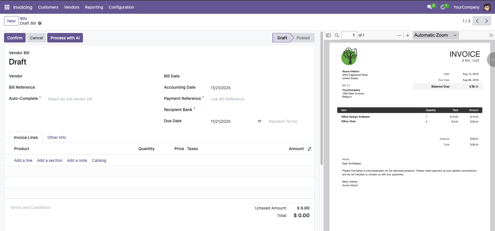
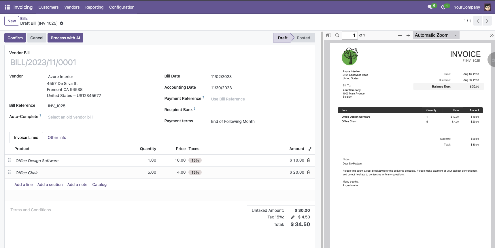

# apx_account_invoice_import_llm

[Español](README.md) · English
Odoo 16 module that reads a supplier invoice (PDF or image) with an OCR step and one LLM call, and turns the result into a draft vendor bill through OCA's `account_invoice_import`. Fork of `account_invoice_import_llm` from [apexive/odoo-llm](https://github.com/apexive/odoo-llm), see [UPSTREAM.md](../UPSTREAM.md).

## What is this for?
- **Process with AI:** a button on draft vendor bills that extracts the data of the attached PDF or image and fills the form.
- **Fallback of the OCA import wizard:** when the invoice has no embedded XML, the wizard uses this extraction instead of failing.
- **One-shot extraction:** the OCR text goes to an assistant (*Invoice Extraction*) in a single call, which returns vendor, dates, amounts and line items. The result is converted to OCA's Invoice Pivot Format, so vendor, product and tax matching are the standard ones.
- **What it extracts:** vendor name and VAT number, invoice number and reference, invoice and due dates, currency, subtotal, tax and total, and line items with description, quantity, unit price and tax rate.

## About the OCR step
The OCR step of this module, as inherited from Apexive, looks for a provider with service `mistral` (from Apexive's `llm_mistral` module, which this repository does not include). Without it, extraction stops with *Mistral provider not configured*.

In this repository the OCR step is replaced by [`serfe_invoice_ocr`](../serfe_invoice_ocr/README.en.md), which runs it through the LiteLLM provider and adds the Argentine (AFIP) behavior. Install `serfe_invoice_ocr` together with this module unless you provide a Mistral provider yourself.

## Requirements / Dependencies
- Odoo 16 (Community)
- Odoo modules: `account_invoice_import` (OCA/edi), `apx_llm_assistant`, `apx_llm_litellm`
- An AI provider account and a LiteLLM proxy, both provided by you

## Installation
1. Make the addon and its dependencies available in your addons path.
2. Install the module (Apps, or `-i apx_account_invoice_import_llm`), preferably together with `serfe_invoice_ocr`.
3. Configure the LiteLLM provider (*LLM → Configuration → Providers*) and assign a model to the *Invoice Extraction* assistant (*LLM → Configuration → Assistants*).

## Usage
1. **Automatic:** upload a PDF or image to a new vendor bill; the EDI decoder chain runs the extraction.
2. **Manual:** on a draft bill with an attached PDF or image, press *Process with AI*.
3. **OCA wizard:** *Accounting → Vendors → Import Vendor Bill*; if no XML is found, the extraction is used as a fallback.

## Security / Access
- No groups, ACLs or record rules are added; standard accounting permissions apply.
- The invoice document is sent to the AI provider you configured. Serfe does not receive it.
- AI output is a suggestion: totals, taxes and the vendor must be checked before posting.

## Licence
AGPL-3
