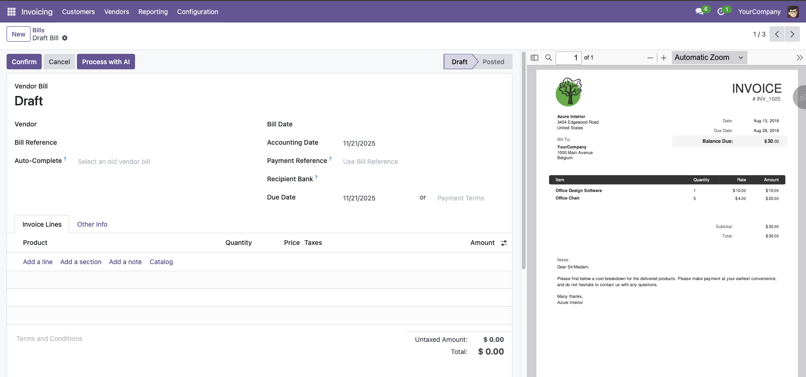
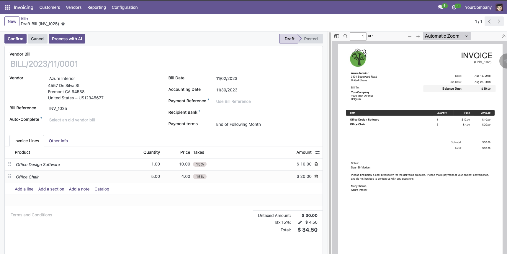

# serfe_account_invoice_import_llm

[English](README.en.md)

Módulo de Odoo 16 que lee una factura de proveedor (PDF o imagen) con un paso de OCR y una llamada a un LLM, y convierte el resultado en un borrador de factura de proveedor a través de `account_invoice_import` de OCA. Fork de `account_invoice_import_llm` de [apexive/odoo-llm](https://github.com/apexive/odoo-llm), ver [UPSTREAM.md](../UPSTREAM.md).

## Para qué sirve
- **Process with AI:** un botón en los borradores de factura de proveedor que extrae los datos del PDF o imagen adjunto y completa el formulario.
- **Respaldo del asistente de importación de OCA:** cuando la factura no trae XML embebido, el asistente usa esta extracción en lugar de fallar.
- **Extracción en un solo paso:** el texto del OCR va a un asistente (*Invoice Extraction*) en una única llamada, que devuelve proveedor, fechas, importes y líneas. El resultado se convierte al Invoice Pivot Format de OCA, así que el reconocimiento de proveedor, producto e impuestos es el estándar.
- **Qué extrae:** nombre y número de IVA del proveedor, número y referencia de la factura, fechas de factura y de vencimiento, moneda, subtotal, impuesto y total, y líneas con descripción, cantidad, precio unitario y alícuota.

## Sobre el paso de OCR
El paso de OCR de este módulo, tal como se hereda de Apexive, busca un proveedor con servicio `mistral` (del módulo `llm_mistral` de Apexive, que este repositorio no incluye). Sin él, la extracción se detiene con *Mistral provider not configured*.

En este repositorio el paso de OCR lo reemplaza [`llm_invoice_ocr`](../llm_invoice_ocr/README.md), que lo ejecuta a través del proveedor LiteLLM y agrega el comportamiento argentino (AFIP). Instalá `llm_invoice_ocr` junto con este módulo, salvo que provean un proveedor Mistral por su cuenta.

## Requisitos / Dependencias
- Odoo 16 (Community)
- Módulos de Odoo: `account_invoice_import` (OCA/edi), `serfe_llm_assistant`, `serfe_llm_litellm`
- Una cuenta con un proveedor de IA y un proxy LiteLLM, ambos provistos por vos

## Instalación
1. Poner el addon y sus dependencias en el `addons_path`.
2. Instalar el módulo (Aplicaciones, o `-i serfe_account_invoice_import_llm`), preferentemente junto con `llm_invoice_ocr`.
3. Configurar el proveedor LiteLLM (*LLM → Configuración → Proveedores*) y asignar un modelo al asistente *Invoice Extraction* (*LLM → Configuración → Asistentes*).

## Uso
1. **Automático:** subir un PDF o imagen a una nueva factura de proveedor; la cadena de decodificadores EDI ejecuta la extracción.
2. **Manual:** en un borrador con un PDF o imagen adjunto, presionar *Process with AI*.
3. **Asistente de OCA:** *Contabilidad → Proveedores → Import Vendor Bill*; si no se encuentra XML, se usa la extracción como respaldo.

## Seguridad / Acceso
- No agrega grupos, ACLs ni reglas de registro; rigen los permisos estándar de contabilidad.
- El documento de la factura se envía al proveedor de IA que configuraste. Serfe no lo recibe.
- La salida de la IA es una sugerencia: totales, impuestos y proveedor deben verificarse antes de publicar.

## Licencia
AGPL-3
